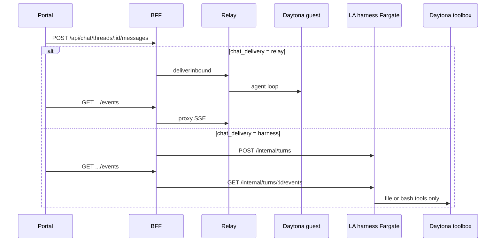

# Portal chat delivery and streaming

How a Portal chat message is accepted, which hop carries the turn, and how SSE events get back to the browser.

Decisions: [ADR 0012](../adr/0012-short-stack-harness.md), [ADR 0013](../adr/0013-daytona-chat-relay-retire.md). Plan: [0015 short stack](../plans/0015-short-stack/overview.md). Tool placement after the hop: [short-stack-tool-placement.md](short-stack-tool-placement.md). Inbound spine (one work item, `sandbox_need`, warm pool): [inbound-work-spine.md](inbound-work-spine.md). SSE tool rows: [portal-chat-tool-events.md](portal-chat-tool-events.md). Idle / mid-turn: [idle-reaper.md](../plans/0008-daytona-agent-sandboxes/idle-reaper.md), [mid-turn-protection.md](../plans/0008-daytona-agent-sandboxes/mid-turn-protection.md).

This is the runtime map. Portal Settings does not own these knobs.

## The two hops

`ChatDelivery` is `"relay"` or `"harness"`. Default is `relay`. Unknown or empty env values fail closed to `relay`.

**Relay.** Browser → BFF → Relay `deliverInbound` → guest gateway inside the Daytona sandbox. The agent loop runs on the guest. Stopping the sandbox kills the turn.

**Harness.** Browser → BFF → Harness HTTP `startTurn` on the always-on Lanyard Agent Fargate task. No `deliverInbound`. Daytona is the toolbox, not the chat loop. No-tool send uses `sandboxNeed: "none"` and does not call `ensure_online` (`lp-vqr0.11`).

The browser never holds Relay or harness tokens. BFF proxies both.



SSE event shapes are the same on both hops. That is the dual-run contract. ADR 0012: HTTP + SSE, not gRPC.

## How BFF picks a hop

Documented resolve was instance persist, then tenant persist, then process env `CHAT_DELIVERY`, then `relay` (see `resolveChatDelivery` in `portal/packages/bff/src/config.ts`). **Phase 10 (`lp-k5c4.13`) dropped the persist column** — request path no longer branches on `tenants.chat_delivery`.

`resolveChatHop` (`portal/packages/bff/src/inbound-spine.ts`) is now **HARNESS_URL wired → spine**. `spineEnabled` does not read `tenants.chat_delivery` (param kept deprecated for rollback). Process env `CHAT_DELIVERY` stays `relay` (legacy fallback only when HARNESS_URL is not wired).

| Layer | Where | Empty means | Used on Send / SSE / context? |
| --- | --- | --- | --- |
| `gateway_instances.chat_delivery` | CP registry PATCH (removed Phase 10) | — | Removed `lp-k5c4.13` — rollback: `ADD COLUMN chat_delivery TEXT CHECK (...)` |
| `tenants.chat_delivery` | `PATCH /internal/tenants/:id/chat-delivery` (deprecated) | — | **Dropped Phase 10** (`lp-k5c4.13`). Request path is spine when `HARNESS_URL` wired. Honesty `GET /api/context` still returns `chat_delivery` via env or `null`. |
| `CHAT_DELIVERY` | BFF process env | `relay` | Legacy fallback only when `HARNESS_URL` not wired. Not consulted on spine Send/SSE/cancel. |
| Default | code | `relay` | Only when `HARNESS_URL` not wired |

`GET /api/context` returns the resolved `chat_delivery` (env only post-Phase 10). Portal honesty copy uses that so Settings/Vault do not claim Relay or Brain RPC on a short-stack hop.

**Phase 10 drop (`lp-k5c4.13`).** EC2 residual `lp-k5c4.14` is closed (0 `runtime_kind=ec2`). Every tenant is Daytona; `HARNESS_URL` wired → inbound spine. No `deliverInbound` on spine tenants. Do not set global `CHAT_DELIVERY=harness`.

**Rollback:** if spine must be reverted, re-add columns (see `portal/packages/control-plane/src/migrate.ts` drop block for SQL) and restore `spineEnabled` to `tenantChatDelivery === "harness" && harnessUrlWired` (pre-Phase 10 `portal/packages/bff/src/inbound-spine.ts`). Provision still forbids global `CHAT_DELIVERY=harness` ([provision-prod-tenant.md](../runbooks/provision-prod-tenant.md)).

Live AWS process default stays `relay` (OPERATOR HOLD). Phase 9 evidence `artifacts/mocklab/lp-k5c4/` shows MockLab on spine.

## Send, stream, cancel

Entry: `POST /api/chat/threads/:threadId/messages`.

1. Auth, thread access, body parse.
2. `hop = resolveChatHop` — `HARNESS_URL` wired → `{ kind: "spine" }` (`lp-k5c4.13`, no tenant persist read). Legacy only when not wired (`CHAT_DELIVERY` env).
3. `resolveChatSendInstance`. Relay looks up the primary gateway instance. Spine no-tool does the same lookup and skips `ensure_online`.
4. Relay only: `ENSURE_ONLINE_ON_CHAT` may wake. Slow wake returns HTTP **202** `{status:"agent_starting"}` and finishes deliver off the CloudFront origin (`lp-vqr0.8`). Gateway 502/503 maps to the same 202 retry path.
5. Persist the user bubble (`lp-v62i.11` / `lp-j39s`) **before** ensure-online kickoff and before `deliverInbound` / enqueue / `startTurn`, so a slow or failed hop still paints. **Relay:** `deliverInbound` (after 202 if the wake was detached). **Spine:** `enqueueInbound` on the room lease (always when wired). HTTP **200** remembers `turn_id` in `HarnessTurnRegistry` (Postgres `harness_turns` when `CONTROL_PLANE_DATABASE_URL` is set, else in-process).
6. `GET /api/chat/threads/:threadId/events` is a second connection. Spine calls `proxyHarnessTurnsUntilAbort` → `openTurnEventStream(turnId)` and forwards Relay-shaped frames. Relay proxies Relay hub SSE. Wake live events (`agent_starting` / `agent_ready`) use the same SSE connection; multi-replica BFF fans them out over Postgres LISTEN/NOTIFY (`lp-k5c4.12`).
7. `POST .../cancel`. Spine interrupts the remembered `turn_id` (durable registry so another replica still finds it). Relay calls `interruptInbound`.

A 200 on Send means the hop accepted the turn. It does not mean tokens have arrived. The UI paints from the SSE connection.

Harness SSE uses a 120s stall watchdog (`lp-k5c4.7`). A silent stream surfaces `Agent turn stalled` instead of hanging forever.

Relay SSE `tool_progress` may call `signalActivityBestEffort` when `SIGNAL_ACTIVITY_ENABLED` is on, debounced 30s. Harness `proxyHarnessBody` does not. Long harness tool turns only have the post-send mid-turn arm.

## Flags on the same send

These are BFF/CP process env, not Settings snapshot fields. `parseEnvFlag` is fail-closed: only `1` / `true` / `yes` / `on` are true. Unset is false. BFF listen logs the booleans. There is no `_unsaid` third state. A name like `signal_activity_enabled_unsaid` means the env key was missing.

| Env | Default | What it does to chat |
| --- | --- | --- |
| `CHAT_DELIVERY` | `relay` | Process default hop. Persist beats this. |
| `HARNESS_URL` | unset | Client wiring. Required in production only when process delivery is `harness`. |
| `SIGNAL_ACTIVITY_ENABLED` | **false** | POST CP `signal-activity`. Message and `tool_progress` arm `mid_turn`. Unset skips the CP call. Chat HTTP still 200. |
| `ENSURE_ONLINE_ON_CHAT` | false | Relay send wakes Daytona. Harness no-tool send skips it. |
| `ENSURE_ONLINE_ON_BRAIN_RPC` | false | Wake before vault/settings/projects, not chat Send. |
| `VAULT_PLANE` | implicit `fs`, or `brain_rpc` if Brain RPC is on | Vault UI plane. `cp_s3` is BFF → CP → S3 with no wake on tree. |
| `BRAIN_RPC_ENABLED` | false | Host Brain RPC. Independent of the chat hop. |
| `IDLE_REAPER_GRACE_MS` | 10 min | CP stop threshold for online Daytona. A leftover comment in `signal-activity.ts` still says 30 min. Code is 10 (`lp-kng.8`). |

`SIGNAL_ACTIVITY_ENABLED` is absent from staging tfvars and from the MockLab harness runbook. Live BFF `:50` has been observed with the flag unset. Mid-turn docs assume the flag is **on** when they describe message/tool_progress arming the lock.

Control Plane idle reaper scans every 60s. If `mid_turn` is active it logs `skipped_mid_turn` and does not stop. Else it stops `runtime_kind=daytona` + `presence=online` when `last_activity_at` is missing or older than grace. **Online + null `last_activity_at` is idle on that scan.** Successful `ensure_online` seeds the timestamp. Flag-off Send does not.

BFF never sends `mid_turn: false` when the assistant finishes. Clear is the 45 minute max hold or a stop. Vendor `DAYTONA_AUTO_STOP_INTERVAL_MINUTES` default 90 ignores `mid_turn`.

```mermaid
flowchart TD
  Send["POST /messages"] --> Hop{"resolveChatHop<br/>HARNESS_URL wired? (lp-k5c4.13)"}
  Hop -->|spine (HARNESS_URL wired)| Enq["enqueueInbound room lease"]
  Hop -->|legacy (no HARNESS_URL)| CD{"CHAT_DELIVERY env"}
  CD -->|relay| EO{"ENSURE_ONLINE_ON_CHAT"}
  CD -->|harness| NT["sandboxNeed none: no ensure_online"]
  EO -->|on| Wake["CP ensure_online; seed last_activity_at"]
  EO -->|off| Deliver["deliverInbound"]
  Wake --> Deliver
  Enq --> Arm["mid_turn before startTurn"]
  NT --> Arm
  Arm --> Start["HarnessClient.startTurn"]
  Deliver --> Sig{"SIGNAL_ACTIVITY_ENABLED"}
  Start --> SSE["GET events: harness proxy + 120s stall watchdog"]
```

## 2026-08-26 MockLab stall

Bead `lp-v62i.8`. Taste send `"hi"` on live MockLab. HTTP 200. Bubble painted. No assistant tokens.

BFF env was `CHAT_DELIVERY=relay`. Tenant persist was `harness`. On current main that pair is `resolveChatHop` → spine (`lp-k5c4.8`), not `requestChatDelivery`. The 2026-08-26 hole was still dual-run plus no mid_turn and no stall watchdog.

`SIGNAL_ACTIVITY_ENABLED` was unset on BFF `:50`. `signalActivityIfNeeded` returned `flag_off`. `lp-j39s` (#664) already moved the call *before* `startTurn`, but the helper still no-ops when the flag is off. Idle reaper stopped box `c3529f09` at 06:37 ET with `idle_grace_ms=600000` and `skipped_mid_turn=0`. Harness proxy had opened turn_37 and never logged completion.

Two stacked failures:

1. Unset activity flag: no `mid_turn`, reaper can stop the toolbox.
2. Harness SSE with no tokens and no watchdog: UI hangs.

Workarounds: PATCH MockLab `chat_delivery` back to `relay` or `null`. Or set `SIGNAL_ACTIVITY_ENABLED=true` on BFF and redeploy. PR #670 (`lp-v62i.8`) would arm `mid_turn` on every message send even when the flag is off, and add a 120s harness stall watchdog. `tool_progress` and `brain_rpc` stay gated. Not merged as of this writing.

## Settings vs these knobs

`GET /api/settings/snapshot` is skills, crons, MCP servers, models, integrations. Agent YAML `agent.max_turns` / `reasoning_effort` live in `$BACKEND_HOME/config.yaml` on the host. Neither is `CHAT_DELIVERY` or `SIGNAL_ACTIVITY_ENABLED`.

When `VAULT_PLANE=cp_s3` and the hop is harness, snapshot comes from harness HTTP. Relay + `cp_s3` still uses fixture / Hermes discover.

## Code map

| Concern | File |
| --- | --- |
| Parse env, `ChatDelivery`, `resolveChatDelivery` | `portal/packages/bff/src/config.ts` |
| `spineEnabled`, `resolveChatHop` (Send/SSE/cancel gate) | `portal/packages/bff/src/inbound-spine.ts` |
| `requestChatDelivery` (honesty/settings), POST messages, GET events, cancel | `portal/packages/bff/src/app.ts` |
| Tenant persist into the request | `portal/packages/bff/src/tenant-resolver.ts` |
| Tenant PATCH | `portal/packages/control-plane/src/app.ts` |
| Discriminated send / interrupt | `portal/packages/bff/src/chat-delivery-send.ts` |
| Harness SSE drain | `portal/packages/bff/src/chat-delivery-events.ts` |
| No-tool vs toolbox instance pick | `portal/packages/bff/src/chat-instance-resolve.ts` |
| `startTurn` / event stream | `portal/packages/bff/src/harness-client.ts` |
| Remembered `turn_id` | `portal/packages/bff/src/harness-turn-registry.ts` |
| Activity helper | `portal/packages/bff/src/signal-activity.ts` |
| Listen log | `portal/packages/bff/src/index.ts` |
| Reaper | `portal/packages/control-plane/src/idle-reaper.ts`, `instance-orchestrator.ts` |
| Live BFF pins | `deploy/environments/platform-staging/terraform.tfvars` |

## Operator checklist

1. Read BFF listen log: `chat_delivery`, `signal_activity_enabled`, `ensure_online_on_chat`, `vault_plane`.
2. Read tenant persist: `GET` tenant `chat_delivery`. Env `relay` plus persist `harness` is MockLab dual-run, not a bug.
3. Do not set global `CHAT_DELIVERY=harness`.
4. A Daytona chat path that can run longer than 10 minutes needs `SIGNAL_ACTIVITY_ENABLED=true`, or message sends that arm `mid_turn` without the flag (PR #670).
5. `skipped_mid_turn=0` on an idle stop during a live turn means the lock was never armed.
