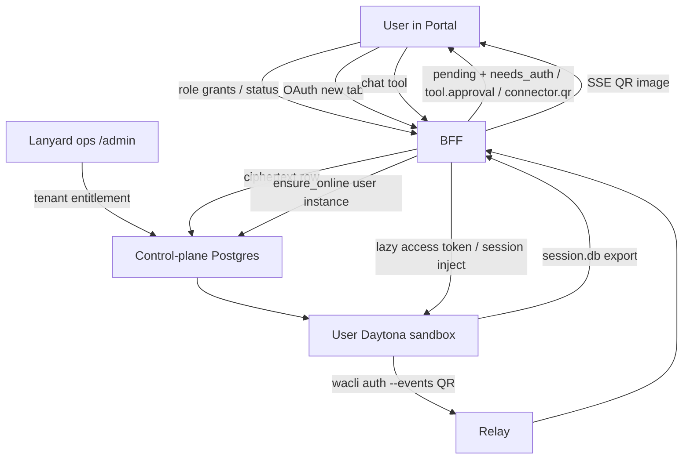

# Portal connectors

**Status:** Frozen v1 design (2026-08-20 grill). Enums and command map: `lp-xhf4.1`.  
**Contract SoT:** [`contracts/connectors-v1/`](../../contracts/connectors-v1/) (`catalog.json`) and `@lanyard/connectors`.  
**Related:** `lp-2qs` (ops console; URL is `/admin`, not `/_platform`), [dual-auth-credential-planes.md](./dual-auth-credential-planes.md), plan 0010 user sandboxes, client-core packs `gws` and `wacli`.

This note is the v1 contract for **Connectors**: one catalog, user OAuth or CLI pairing, control-plane ciphertext, lazy inject into a **user** Daytona sandbox, chat approval gates, and Lanyard ops at `/admin`.

`/_platform` in S3 (`tenants/{id}/_platform/…`) is a vault marker prefix. It is not a product URL.

---

## 1. What a connector is

One catalog object. Not three Tools tabs.

```ts
type ConnectorId = "google" | "hubspot" | "whatsapp" | "github"; // closed; add members when they ship
type ConnectorRuntime = "api" | "cli" | "mcp" | "skill";
type ConnectorPrincipal = "user" | "tenant"; // v1 Google/HubSpot/WhatsApp/GitHub are "user"
type ConnectorAuthKind = "oauth" | "cli_qr";

type ActionClass =
  | "gmail.read" | "gmail.draft" | "gmail.send"
  | "calendar.read" | "calendar.write"
  | "drive.read" | "drive.write"
  | "hubspot.read" | "hubspot.write"
  | "whatsapp.read" | "whatsapp.send"
  | "github.read" | "github.write";

type ActionGate = "sticky" | "every_call";
```

Adding a connector, runtime, or `action_class` is a **contract change**. Free-text names from config are illegal.

| Id | Principal | Auth | v1 runtimes | Bound host tools |
| --- | --- | --- | --- | --- |
| `google` | `user` | `oauth` (Lanyard Google app) | `cli` (`gws`) + `skill` | existing `gws-gmail-*`, calendar, drive skills |
| `hubspot` | `user` | `oauth` (Lanyard HubSpot app) | `api` + `cli` + `skill` | HubSpot REST/CLI + skill copy |
| `whatsapp` | `user` | `cli_qr` (`wacli auth`) | `cli` + `skill` | `wacli` pack |
| `github` | `user` | `cli_token` (`gh auth login` in the user sandbox) | `cli` (`gh`) + `skill` | `gh` CLI; no OAuth app in v1 (lp-8sh4.5) |

MCP may attach later on the same `connector_id`. Same OAuth/QR row. No second connect.

GitHub and Outlook are **not** v1 enum members until they ship.

---

## 2. Surfaces

Same `@lanyard/web` tarball. Two cookies.

| Person | Where | Cookie | Job |
| --- | --- | --- | --- |
| User | Tenant Portal → **Connectors** (today’s Tools tab, renamed) | `lanyard_session` | Own Connect / Refresh / Disconnect, sticky flags, status |
| Tenant admin | Same Portal, Connectors → **Team** (`admin` role) | `lanyard_session` | `(role × connector)` on/off, HubSpot pin, team **status** |
| Lanyard ops | `https://app.withlanyard.com/admin` | `lanyard_ops_session` | Tenant may use `{google, hubspot, whatsapp, github}`. Cross-tenant status. Never OAuth. Never QR. |

Reserve path segment `admin` in `RESERVED_TENANT_PATH_SEGMENTS` and the Vite proxy list. Tenant slug `admin` is forbidden. Ops cookie on `/demo` is not god-mode. Tenant cookie on `/admin` is unauthenticated.

Users never open `/admin`. Ops never finish Google/HubSpot consent and never scan WhatsApp.

### Connectors page rows

One page, two kinds of row.

1. **SaaS connectors** (`google`, `hubspot`, `whatsapp`, `github`): name, runtime(s), status (`not_connected` / `connected` / `needs_reauth` / `pairing`), Connect / Refresh / Disconnect.
2. **Bound host tools** sit **under** that connector (`gws-gmail-send` is not its own connector).
3. Host skills/MCP with **no** `connector_id` (proposal pipeline, web-search) are a second group, “On this brain.” Enable/disable only. No OAuth column.

**Models stay off this page.**

Tenant admin sees, per user: status, provider account label (Gmail address, HubSpot email + portal id, WhatsApp phone/JID), last hydrate/error class, optional “drafts: always” flag. Never tokens, never `session.db`, never PKCE. v1 has no admin-impersonation Disconnect; turning the role grant **off** deletes the row (see §7).

---

## 3. Grants

Two writers, different objects. No per-user grant table.

| Who | Writes |
| --- | --- |
| Platform (`/admin`) | Tenant may use connector ids |
| Tenant admin | `(role, connector_id)` on/off. HubSpot `hubspot_portal_id` pin (clear allowed) |
| User | Completes OAuth or WhatsApp QR if their role is on |

Alice can use Google iff the tenant is entitled **and** her role has `google` **and** she finished consent.

OAuth **scopes are fixed per connector**, not per Lanyard role. Google’s and HubSpot’s own ACLs still apply after connect. Promoting contributor → admin does not require a second Google consent.

### Google scopes (one consent)

- `openid` `email`
- `gmail.readonly` `gmail.compose` `gmail.send`
- `calendar.readonly` `calendar.events`
- `https://www.googleapis.com/auth/drive` (full Drive)

`drive.file` is not enough for `gws drive` search on existing company folders. Drive **writes** are still `every_call` in chat.

Calendar later-scope drama is already included. Reconnect is only if we add yet more Google APIs.

### HubSpot scopes (one consent)

Read + write on: contacts, companies, deals, notes, tasks, meetings, plus OAuth identity (user email + portal id). No Settings, no users admin, no marketing blast. Tickets/custom objects: later reconnect on the same `hubspot` row.

**Sticky pin:** first successful HubSpot connect in the tenant writes `hubspot_portal_id`. Later connects whose token portal mismatches are rejected. Tenant admin can clear the pin; next successful connect re-pins. Google has no equivalent pin in v1.

---

## 4. Token and session storage

Control-plane Postgres. One row `(tenant_id, user_id, connector_id)`. KMS ciphertext. BFF/host writes it. Daytona is **not** source of truth.

| Connector | What the row holds | What the sandbox may hold |
| --- | --- | --- |
| `google`, `hubspot` | access + refresh + expiry + granted scopes + account label | Short-lived **access token** cache after lazy inject |
| `whatsapp` | encrypted `session.db` (whatsmeow keys) + linked JID/phone | Live `session.db` on the user sandbox disk after inject/restore |

Never store OAuth refresh tokens as durable Daytona files. Never upload `wacli.db` (messages + FTS) or `media/` to CP. Message bodies stay on the user box and re-sync from WhatsApp after restore.

Idle stop **retains** `sandbox_id` (existing Daytona path). CLIs and MCP **binaries** stay on that disk. OAuth/session material is rebuilt from CP when missing or expired.

### Lazy inject

Per connector, per wake, first **use** (or first pairing). Unused connectors never touch the guest.

1. User sandbox starts with no Google/HubSpot/WhatsApp secrets.
2. First tool need (or Connect) → CP refreshes if needed → inject that connector only.
3. Reuse until 401/expiry, then refresh from CP and inject again.
4. Idle stop drops the OAuth cache. WhatsApp `session.db` may remain on retained disk; if the sandbox is **destroyed**, restore `session.db` from CP and run `wacli sync` (never a new QR unless WhatsApp unlinked the device).

First successful connect for a user-principal connector **provisions** `scope=user` instance (`owner_user_id`) if missing. Tenant sandbox never receives these credentials. Entitlement to `google` / `hubspot` / `whatsapp` implies user instances are allowed. Connecting does not have to wake vCPU; it creates the mapping. Inject still waits for first use.

Scheduled tasks that need a user-principal connector run on **that user’s** sandbox as that user. Tenant cron does not get Gmail or WhatsApp in v1.

---

## 5. Chat: OAuth (Google, HubSpot)

New **tab** (`window.open(url, "_blank")`). Not an iframe. Not a tiny popup. If blocked, the wizard keeps a normal “Open Google” link, still a new tab. Do not navigate the Portal itself to the provider.

1. BFF `/api/connectors/{id}/oauth/start`: PKCE, signed one-time `state` bound to `tenant_id`, `user_id`, `thread_id`, pending tool.
2. Provider → BFF `/api/connectors/{id}/oauth/callback`. Writes CP. Tiny “you can close this” page. `postMessage` to opener.
3. Tenant session that does not match `state` is rejected. Ops cookie cannot complete this.

Connectors-page Connect has no pending tool.

---

## 6. Chat: WhatsApp QR (`wacli`)

WhatsApp is a **linked device**, not OAuth. The user scans WhatsApp → Linked devices. Pairing must happen **on that user’s sandbox** so `session.db` is born there. The QR must appear **in Portal chat**, not in a tty the user cannot see.

Do **not** forward terminal ASCII art into the timeline. Proportional chat fonts will not scan. `wacli` already has an external-renderer path.

### Command on the user sandbox

```bash
# stderr: NDJSON lifecycle; includes raw QR payload
# with --events, default --qr-format terminal skips ASCII and only emits events
wacli auth --events
```

From `wacli` 0.11.0 (`cmd/wacli/auth.go`):

- `--events` writes `{ "event": "qr_code", "data": { "code": "<raw payload>" }, "ts": … }` on **stderr**.
- `--qr-format text` prints that payload on stdout (cannot combine with `--json`).
- QR **rotates** on transient websocket drop before pairing completes. A new `qr_code` event replaces the previous code.
- Passkey-gated pairing is unsupported upstream; auth fails with an actionable error. Surface that honestly. Do not spin unusable QR codes.
- Optional `--phone +E164` emits `pair_code` instead. v1 chat ships QR; phone pairing can be a later wizard option.

### Path (no LLM in the loop)

```text
User confirms Connect WhatsApp (chat wizard or Connectors page)
  → BFF pending_connector_use (connector=whatsapp)
  → ensure user sandbox online
  → host starts `wacli auth --events` with WACLI_STORE_DIR on that sandbox
  → host reads stderr NDJSON (not the model)
  → outbound portal_event connector.qr { connector_id, code, ts }
  → BFF SSE → chat bubble renders a real QR from `code` (SPA QR library)
  → later qr_code events: same bubble, replace the image (codes expire)
  → pairing success: host stops showing QR
  → host exports session.db only → BFF → CP ciphertext
  → auth status (phone / linked_jid) stored as account label
  → approval + inject/use as for any other connector
```

`portal_event: "connector.qr"` is a new chat event, sibling to reserved `tool.approval`. It is **not** `tool_progress`. The agent does not “see” the QR payload in its prompt. If the model needs to know pairing is in progress, give it a short status string, not the code.

Render in the SPA from the raw `code` string (the same payload `--qr-format text` prints). Optional: also show “Open WhatsApp → Linked devices → scan.”

### After pairing

- Live copy: user sandbox `$WACLI_STORE_DIR/session.db` (0600).
- Durable copy: that file encrypted on the CP connection row. **Not** `wacli.db`, **not** media.
- `wacli sync` may run on the sandbox (history stays local, bounded by `WACLI_SYNC_MAX_*`).
- Disconnect: `wacli auth logout` when the box is up, delete CP row, drop session files. Same as OAuth revoke.
- New sandbox: write `session.db` from CP, `wacli sync`. If WhatsApp unlinked the device, status `needs_reauth` and a new QR. User does not lose the connector entitlement.

ASCII-in-chat is a degraded fallback only if QR image rendering fails, and it must be a monospace screenshot-quality block. Default is a scannable image.

---

## 7. Lifecycle

| Event | CP row | Provider / WhatsApp | Sandbox |
| --- | --- | --- | --- |
| User Disconnect | Delete | Google/HubSpot revoke; `wacli auth logout` if up | Drop cache / session.db |
| Refresh | Keep; rotate access token (OAuth) | Refresh grant | Next inject |
| Refresh / session fail | Keep; `needs_reauth` | — | Wizard or new QR |
| Role or tenant loses connector | Delete those rows; revoke/logout | Same | Same |
| User removed from tenant | Delete all their connection rows | Same | Same |
| Clear HubSpot pin | Pin cleared; tokens stay | — | — |

No soft-delete of secrets. Audit `connector.disconnected` (metadata only). Refresh is not Disconnect. Failed refresh does not delete the row.

---

## 8. Approval gates

On top of auth, not instead of it. Wire: existing reserved `tool.approval`.

Closed **command → `action_class`** map in the connector contract. The LLM does not pick the gate. Unmapped command = `every_call` (high-gate). Do not run until approved.

| Class | Gate | Examples |
| --- | --- | --- |
| `gmail.read` | sticky | list/get/triage |
| `gmail.draft` | sticky | drafts create/update |
| `gmail.send` | every_call | messages send, drafts send |
| `calendar.read` | sticky | agenda, get |
| `calendar.write` | every_call | insert, invite, update, delete |
| `drive.read` | sticky | list, get, search |
| `drive.write` | every_call | upload, share, delete |
| `hubspot.read` | sticky | get/search six CRM objects |
| `hubspot.write` | every_call | create/update any of those objects |
| `whatsapp.read` | sticky | `wacli messages list/search`, chats, contacts |
| `whatsapp.send` | every_call | `wacli send` |

Sticky **Always** is per user, per connector, per class, JSON map on the connection row. Durable across chats. Disconnect clears it. User can clear one class from Connectors without Disconnect.

High-gate has **no Always**. Bubble: Approve this call / Reject, every time. Reject skips that tool; it does not Disconnect.

### Order (first Gmail draft, analogous for others)

1. **Connect** if no healthy row (`needs_auth` or WhatsApp QR). No approval yet.
2. **Approve class** if not sticky.
3. **Inject** that connector into the user sandbox.
4. **Run** the mapped command.
5. Later **send/write**: skip 1–3 if already connected and hydrated; still show high-gate.

One pending connector, one class, one bubble. BFF stores `pending_connector_use` (TTL minutes): connector, tool, args, user. OAuth/QR success resumes **that one tool**, not the whole turn. Prefer Gmail pending = `drafts.create`. Connect from the page has no pending tool.

---

## 9. Request path (mental model)



Browser never talks to CP, Relay internals, or Daytona. WhatsApp QR payload does not go through the model.

---

## 10. v1 non-goals

- Tenant-principal connectors (company HubSpot token, shared inbox, company WhatsApp WABA).
- Per-user grant table; platform clicking Alice’s HubSpot bit.
- BYO Google/HubSpot OAuth apps.
- Drive-lite (`drive.file` only).
- MCP as a required HubSpot runtime.
- GitHub, Outlook, Slack-as-connector (Slack gateway already exists on another path).
- `/_platform` as a URL.
- Storing WhatsApp message history in CP.
- ASCII QR as the primary UX.

---

## 11. Implementation sketch (types)

```ts
type ConnectionStatus = "not_connected" | "pairing" | "connected" | "needs_reauth";

type ConnectorConnection = {
  tenant_id: string;
  user_id: string;
  connector_id: ConnectorId;
  status: ConnectionStatus;
  account_label: string | null; // email, HubSpot user, WhatsApp phone
  hubspot_portal_id?: string | null; // denormalized from tenant pin for display
  sticky: Partial<Record<ActionClass, true>>;
  // ciphertext columns, not returned to the SPA:
  // oauth_refresh, oauth_access, oauth_expiry, whatsapp_session_db
};

type TenantConnectorEntitlement = {
  tenant_id: string;
  connector_id: ConnectorId;
  enabled: boolean;
  hubspot_portal_id?: string | null;
};

type RoleConnectorGrant = {
  tenant_id: string;
  role_id: string;
  connector_id: ConnectorId;
  enabled: boolean;
};
```

Host command map (normative, lives in [`contracts/connectors-v1/catalog.json`](../../contracts/connectors-v1/catalog.json), not in the model). Typed mapper is `@lanyard/connectors` `classifyCommand(argv)`. Argv only.

```text
gws gmail users drafts create     → gmail.draft
gws gmail users messages send     → gmail.send
gws calendar +agenda              → calendar.read
gws calendar events insert        → calendar.write
gws drive files list              → drive.read
wacli messages list               → whatsapp.read
wacli send text                   → whatsapp.send
# unmapped → every_call, do not run until approved
```

---

## 12. Proof later (not this note)

- User sandbox provision on first Google connect; tenant sandbox `printenv` has no token.
- OAuth callback cannot be completed with a tenant cookie on the wrong user or an ops cookie.
- WhatsApp: `wacli auth --events` QR scans from the chat image; `session.db` round-trips CP → new sandbox without a second scan while the phone still lists the linked device.
- `wacli.db` never appears in CP.
- High-gate send cannot be sticky even if the model asks.
- Unmapped `gws` subcommand does not run.
