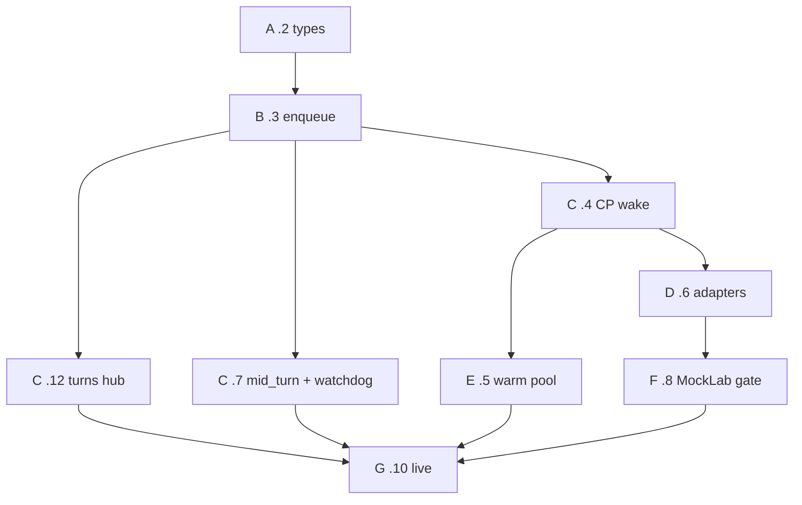

# 0019 parallel waves

How to drain `lp-k5c4` without two agents editing the same files. Workflow: `.grok/workflows/inbound-spine-ship.rhai` (`auto_merge=true`).

Serial where files collide. Parallel where they do not. Merge each wave before the next so dependents rebase on `main`.

## File groups (do not pair two from the same row)

| Group | Paths | Beads |
| --- | --- | --- |
| shared types | `portal/packages/shared/src/harness/` | `.2` |
| queue + send hook | new inbound queue module, thin `app.ts` send | `.3` |
| CP wake/stop | `idle-reaper.ts`, `warm-pool.ts`, `instance-orchestrator.ts` | `.4` then `.5` |
| BFF SSE / registry | `app.ts` events, `chat-delivery-events.ts`, `thread-live-events.ts` | `.12` then `.7` |
| callers | `channel-adapter-deliver.ts`, mailbox-hop, scheduled-task-harness-fire | `.6` |
| gate | `app.ts` `requestChatDelivery`, config | `.8` |
| rust later | `portal/packages/inbound-leaser/` | `.9` skip until contract proves |
| live / residual | ops, terraform HOLD | `.10` `.14` `.13` |

`.4` and `.7` both want `app.ts` if enqueue is inlined. Keep enqueue in its own module so `.4` can touch CP while `.7` touches SSE.

## Waves

**Wave A (now).** `.2` only. Type parse in shared. Unblocks enqueue.

**Wave B.** `.3` only. Postgres `SKIP LOCKED` lease + `spineEnabled` send hook. Unblocks the fan-out.

**Wave C (first real parallel).** After `.3` is on `main`:

| Lane | Bead | Why disjoint |
| --- | --- | --- |
| CP | `.4` toolbox wake + `stop_after` | orchestrator / reaper |
| SSE | `.12` durable `harness_turns` | new table + events hub |
| mid_turn | `.7` | `signal-activity.ts` + stall timer in `chat-delivery-events.ts` |

If `.12` and `.7` both need `app.ts` event wiring, run `.12` then `.7` in C2. Prefer extracting the hub so they do not share a file.

**Wave D.** `.6` callers + classifier. Needs `.4` merged so toolbox enqueue exists.

**Wave E.** `.5` warm pool (CP, after `.4`). Can overlap `.6` if `.6` stays in BFF adapter files.

**Wave F.** `.8` MockLab `spineEnabled` gate. Needs `.6`.

**Wave G.** `.10` live evidence. Needs `.5` `.6` `.7` `.8` `.12`.

**Wave H.** `.13` column drop after `.10` and `.14`. `.14` EC2 residual is human/ops; do not auto-implement in ship waves. `.9` Rust is a later swap, not this drain.

Concurrency cap: 3. Wave C is the only 3-wide batch. Everything else is 1 unless `.5` and `.6` are file-split.

Ship: one PR per bead, squash merge when local tests pass. Do not start `.9` or `.14` in the auto drain.
